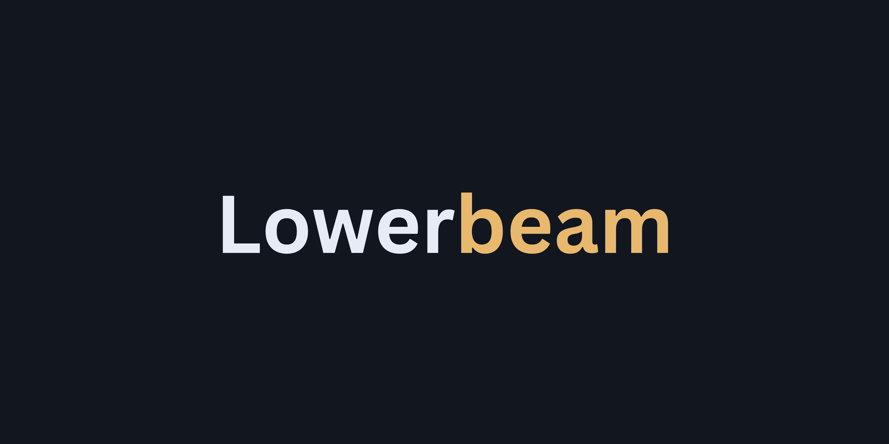
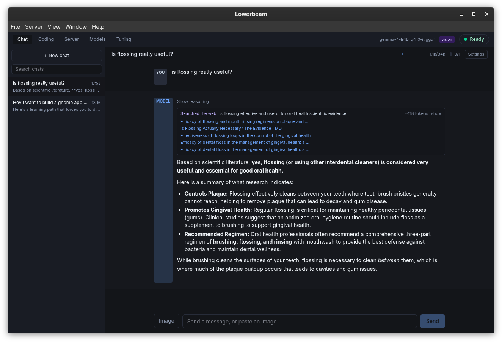

# Lowerbeam



<div align="center">
<b>The local AI workbench for small GPUs.</b>

[](https://github.com/giobuilds/lowerbeam/actions/workflows/ci.yml)
[](https://img.shields.io/github/v/release/giobuilds/lowerbeam)
[](https://img.shields.io/github/license/giobuilds/lowerbeam)
[](https://github.com/giobuilds/lowerbeam/releases)
</div>

Lowerbeam helps you get the most out of local models on an 8 GB card. It sets up the official [llama.cpp](https://github.com/ggml-org/llama.cpp) for you, or uses the one you already have, and gives you one desktop app to pick a model that fits, launch it well, and actually use it.

- **Fits your card.** VRAM and speed estimates before you download, tuned launch settings, and clear reasons when something won't fit.
- **Ready in five minutes.** It finds llama.cpp, or downloads and verifies the official build. No terminal needed.
- **Chat, tools and coding.** Chat with compaction for long conversations, web tools, MCP servers, and a sandboxed coding mode that only ever edits a copy of your project.
- **Yours.** Everything runs locally, with no telemetry.

Lowerbeam uses the official llama.cpp builds and never forks or bundles them. It runs on Linux (x86_64) today.

[Roadmap](ROADMAP.md) · [Contributing](CONTRIBUTING.md) · [Discussions](https://github.com/giobuilds/lowerbeam/discussions)


---

## Install

Download `Lowerbeam.AppImage` from [Releases](https://github.com/giobuilds/lowerbeam/releases), make it executable, and run it:

```bash
chmod +x Lowerbeam.AppImage
./Lowerbeam.AppImage
```

Or install the RPM on Fedora and its relatives. 

On first run, if no llama.cpp is found, Lowerbeam offers to download the official Vulkan build (about 30 MB) or the CPU build into its own data folder. That build needs glibc 2.34 or newer. You can point it at a build of your own instead. Checking for a newer official build is off until you turn it on.

## What you get

| Area | What it covers |
| --- | --- |
| **Server** | Launch llama.cpp, live log, GPU/VRAM, crash hints, binary check that actually generates tokens |
| **Local API** | OpenAI-compatible endpoint for editors and agents (`lowerbeam serve`) |
| **Models** | Scan GGUF on disk, VRAM estimate (or `--fit`), remembered launch settings |
| **Chat** | Streaming markdown, search/export, images, JSON/GBNF constraints, compaction |
| **Downloads** | Hugging Face search with fit and rough speed before you pull |
| **Coding** | Inspect a project, or edit in a copy you review and apply; optional sandboxed `run` |
| **MCP** | Extra tools from stdin/stdout MCP servers |
| **Tuning** | `llama-bench` sweep for throughput settings |

## Requirements

**Linux on x86_64 only.** Releases are an AppImage and an RPM. Windows and macOS are not supported yet (coding run mode needs bubblewrap).

| | Needed |
| --- | --- |
| Distro | Any x86_64 Linux the AppImage runs on; RPM for Fedora and relatives |
| glibc | 2.25+ (Electron); official llama.cpp download needs 2.34+ |
| llama.cpp | Unified `llama` CLI or `llama-server`, or let Lowerbeam download one |
| GPU | Whatever your llama.cpp build supports (Vulkan, ROCm, CUDA, or CPU) |
| Memory | Enough for the model you launch; the Server tab says what fits first |

*Edit and run* also needs bubblewrap and unprivileged user namespaces. Other coding modes work without them.

## Build from source

```bash
npm install
npm run dev        # renderer hot-reload
npm test           # unit suites
npm run dist       # AppImage + RPM in dist/
```

Node 22.12 or later. On Fedora, `libxcrypt-compat` is needed for the RPM target.

## Privacy and security

No telemetry, analytics or account. [PRIVACY.md](PRIVACY.md) lists every network connection and how to turn each off. To report a vulnerability, use GitHub's private reporting (**Security** → **Report a vulnerability**). See [SECURITY.md](SECURITY.md).

## Licence

MIT. See [LICENSE](LICENSE).
